## POBIERANIE WTYCZKI

Otwórz stronę https://github.com/comfino/Magento-2.3/releases i pobierz najnowszą wersję wtyczki.

## INSTALACJA

Magento 2.3.5+
-------

**Przed instalacją modułu zalecane jest wykonanie kompletnej kopii zapasowej katalogu Magento.**

Po pobraniu archiwum comfino.zip i rozpakowaniu, przenieś zawartość katalogu *comfino* do katalogu modułów Magento.

Docelowa lokalizacja: *magento/app/code/Comfino/ComfinoGateway*

gdzie:

* *magento* - nazwa katalogu bazowego sklepu (może być inna niż w powyższym przykładzie)
* *ComfinoPay*, *ComfinoGateway* - podkatalogi, które należy utworzyć w katalogu *app/code*

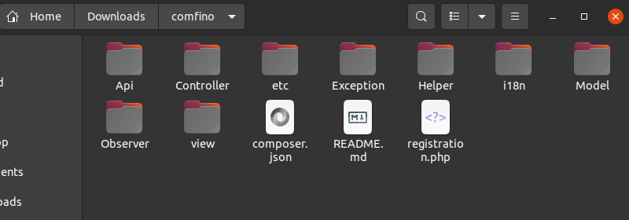
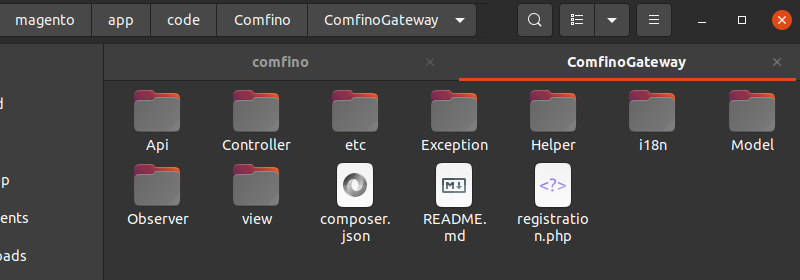

Po skopiowaniu plików wywołaj poniższe polecenie w celu sprawdzenia, czy nowy moduł został rozpoznany:

`./bin/magento module:status`

Wykonane polecenie powinno zwrócić odpowiedź podobną do poniższej:

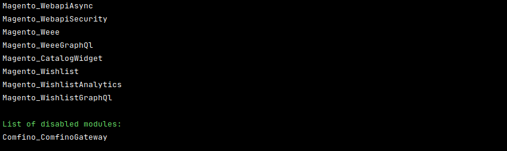

Moduł *Comfino_ComfinoGateway* powinien być na liście nieaktywnych modułów.

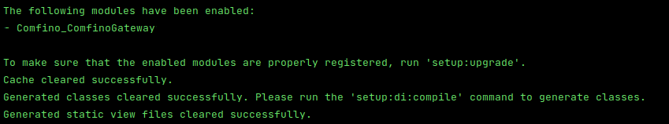

W celu aktywacji modułu wywołaj poniższe polecenia:

* `./bin/magento module:enable Comfino_ComfinoGateway --clear-static-content`
* `./bin/magento setup:upgrade`
* `./bin/magento setup:di:compile`
* `./bin/magento setup:static-content:deploy -f`
* `./bin/magento cache:flush`

Po wykonaniu powyższych czynności zaloguj się do panelu administracyjnego Magento, aby skonfigurować zainstalowany moduł.

## KONFIGURACJA

Aby uzyskać dostęp do ustawień modułu, wykonaj poniższe kroki:

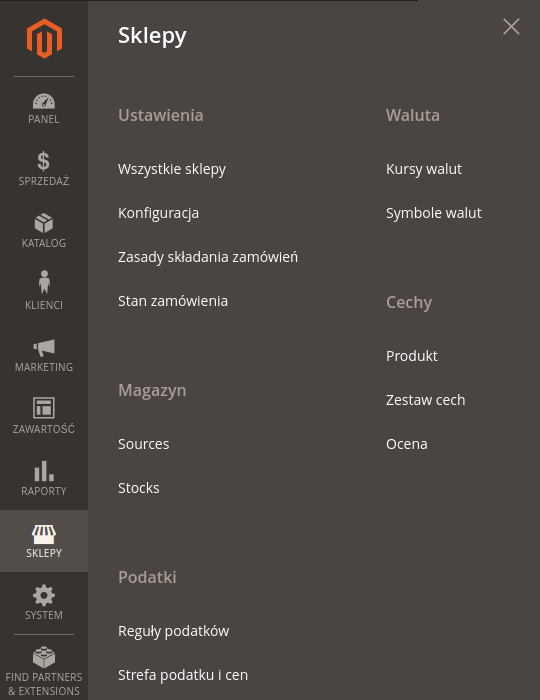
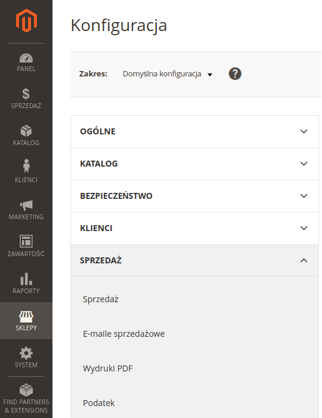
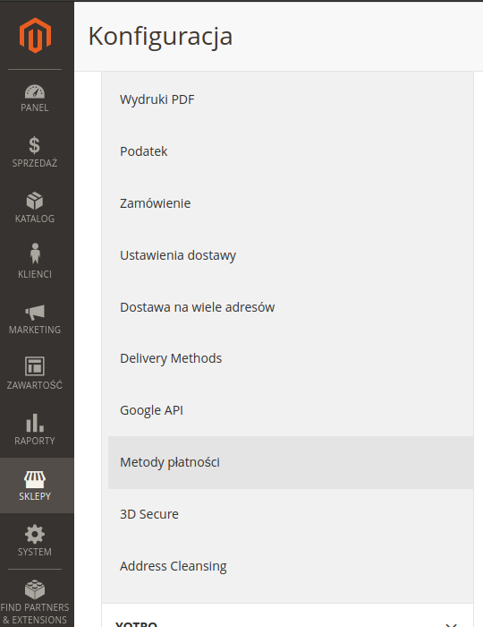
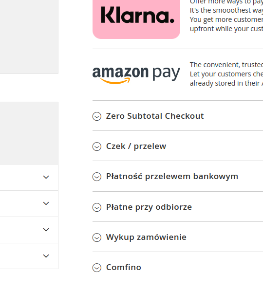

## SEKCJE KONFIGURACJI

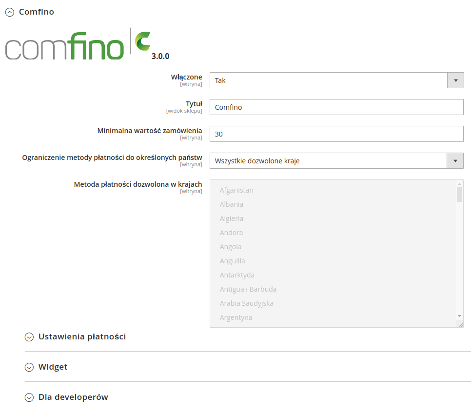

Parametry konfiguracyjne modułu są pogrupowane kategoriami odpowiadającymi rozwijanym sekcjom panelu konfiguracyjnego: `"Ustawienia płatności"`, `"Widget"`, `"Dla developerów"`.
Ostatnia sekcja `"Diagnostyka wtyczki"` nie zawiera żadnych parametrów do ustawienia i pełni funkcję informacyjno-diagnostyczną. Zawiera między innymi lokalny dziennik błędów (log błędów).

Przed użyciem płatności ComfinoPay, moduł musi zostać skonfigurowany.

Najważniejsze pole, które musi być uzupełnione, to pole `"Klucz API"` z sekcji `"Ustawienia płatności"`.
W sekcji `"Dla developerów"` znajduje się pole drugiego klucza - `"Klucz API środowiska testowego"`.

Pola parametrów konfiguracyjnych:

**Ustawienia płatności**

* **Włączone** — status aktywności modułu ComfinoPay (widoczność na liście metod płatności w koszyku)
* **Tytuł** — tekst wyświetlany na liście metod płatności (domyślnie `"ComfinoPay"`)
* **Minimalna wartość zamówienia** — wartość koszyka, od której dostępna jest płatność ComfinoPay (domyślnie: 30 zł)
* **Ograniczenie metody płatności do określonych państw** — kraje, dla których dostępna jest płatność ComfinoPay (domyślnie: brak ograniczeń)
* **Klucz API** — unikalny klucz dostępowy umożliwiający komunikację modułu z API ComfinoPay (otrzymasz go od przedstawiciela ComfinoPay)

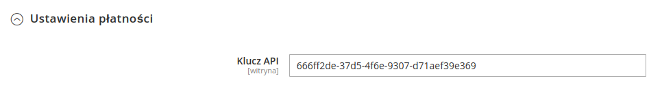

**Widget**

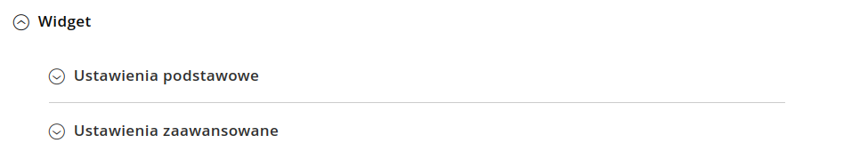

**Ustawienia podstawowe**

* **Widget włączony?** — przełącznik aktywacji/deaktywacji widgetu promocyjnego na stronie produktu
* **Typ widgetu** — sposób prezentacji widgetu [`Widget tekstowy`, `Widget graficzny z banerem`, `Widget graficzny z kalkulatorem rat`]
* **Typ oferty** — typ promowanej oferty finansowania [`Raty zero procent`, `Niskie raty`, `Zapłać później`, `Odroczone płatności dla firm`]

Dostępność typów ofert na liście jest uzależniona od indywidualnej umowy i może różnić się od tej opisanej w dokumentacji.

**Ustawienia zaawansowane**

* **Selektor elementu ceny widgetu** — element dokumentu HTML zawierający cenę produktu
* **Selektor elementu zakotwiczenia widgetu** — element kontenera widgetu (w nim jest osadzany widget)
* **Wykrywanie zmian ceny — selektor kontenera** — element dokumentu HTML zawierający w sobie element ceny bezpośrednio lub pośrednio używany do śledzenia zmian cen i przeliczania ofert
* **Wykrywanie zmian ceny — poziom hierarchii kontenera** — poziom hierarchii DOM używany do śledzenia zmian cen i przeliczania ofert
* **Metoda osadzania** — sposób orientacji widgetu względem elementu kontenera [`INSERT_INTO_FIRST`, `INSERT_INTO_LAST`, `INSERT_BEFORE`, `INSERT_AFTER`]
* **Kod inicjalizacji widgetu** — skrypt JavaScript inicjalizujący widget na stronie produktu (wprowadzanie zmian niezalecane dla niezaawansowanych użytkowników bez znajomości JavaScript)

Szczegółowe informacje o działaniu widgetu i jego opcjach konfiguracyjnych znajdziesz w osobnej [dokumentacji widgetu ComfinoPay](https://comfino.pl/widgets/comfino-magento/pl).

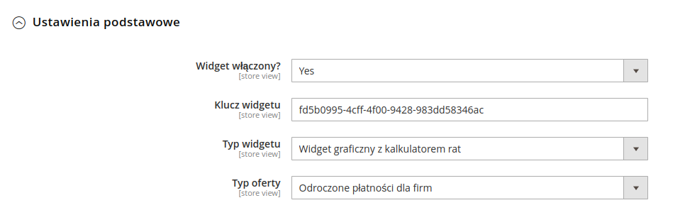
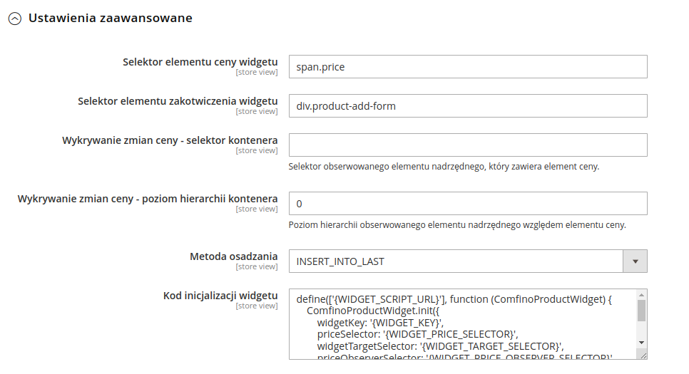

**Dla developerów**

* **Użyj środowiska testowego** — przełącznik aktywacji/deaktywacji trybu deweloperskiego
* **Klucz API środowiska testowego** — unikalny klucz dostępowy umożliwiający komunikację modułu z testowym API ComfinoPay

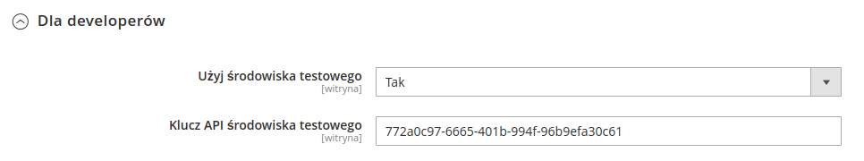

**Uwaga**

Przed uruchomieniem płatności na sklepie produkcyjnym, wyłącz tryb deweloperski, aby zablokować użycie środowiska testowego płatności ComfinoPay.

**Diagnostyka wtyczki**

Sekcja zawiera informacje techniczne o wtyczce i środowisku (wersja wtyczki, wersja sklepu, wersja PHP i serwera www, itp.).\
Zawiera też listę ostatnich błędów wraz z podglądem lokalnego dziennika błędów (log błędów).

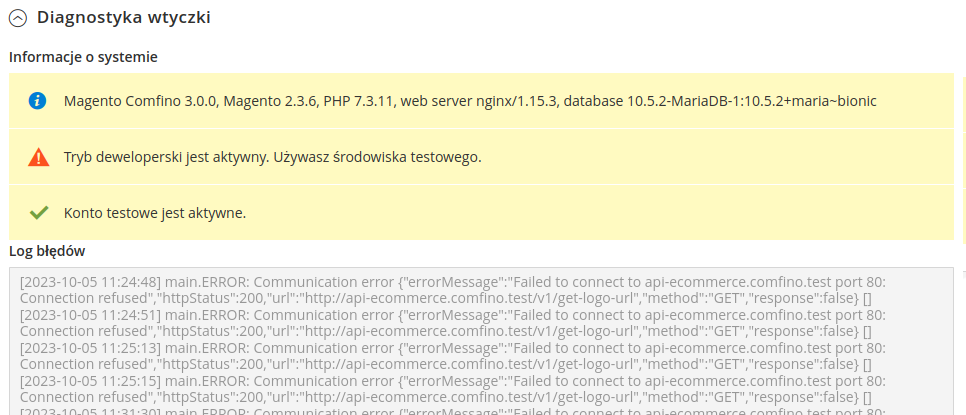

Informacja o aktywności trybu deweloperskiego jest wyświetlana w sekcji `"Diagnostyka wtyczki"`.
W trybie tym wtyczka używa klucza z sekcji `"Dla developerów"` do komunikacji z testowym API ComfinoPay. Klucz środowiska testowego również otrzymasz od przedstawiciela ComfinoPay.

## DEAKTYWACJA

W celu deaktywacji modułu należy wywołać w konsoli poniższe polecenie z poziomu katalogu głównego Magento:

`./bin/magento module:disable Comfino_ComfinoGateway`

## UWAGI

* Moduł płatności ComfinoPay wymaga ustawienia numeru telefonu klienta jako wymaganego w procesie wprowadzania danych kontaktowych klienta. Numer telefonu jest używany do przesyłania kodów i informowania klienta o statusie transakcji, na dalszym etapie procesowania płatności ComfinoPay. W przypadku braku numeru telefonu transakcja płatnicza ComfinoPay zakończy się błędem wyświetlonym na stronie sklepu.
* System notyfikacji modułu wymaga dostępności metody HTTP "PUT". Moduł otrzymuje informacje o zmianach statusu transakcji ComfinoPay i stosownie zmienia wewnętrzny status zamówienia w Magento. W przypadku problemów z notyfikacjami należy sprawdzić ustawienia serwera www w Twoim panelu hostingu.
* Cron Magento musi działać (`bin/magento cron:install`). Anulowania zamówień i raporty błędów, których nie udało się od razu wysłać do ComfinoPay, trafiają do kolejki i są wysyłane przez cron co kilka minut. Gdy żądania czekają w kolejce dłużej niż 30 minut, panel administracyjny wyświetla komunikat, a sekcja `"Diagnostyka wtyczki"` pokazuje ich liczbę.
* Dziennik debugowania i dziennik błędów ComfinoPay są zapisywane do plików dziennych w katalogu `var/log` (`comfino_debug-RRRR-MM-DD.log`, `comfino_errors-RRRR-MM-DD.log`); przechowywanych jest 30 ostatnich plików. Pola z danymi klientów (imię i nazwisko, e-mail, telefon, adres, NIP), klucze i podpisy są w nich maskowane.
* Niestandardowe arkusze stylów (paywall, baner i kalkulator) muszą być adresami `https://` w domenie Twojego sklepu.
* **Aktualizacja z wersji 4.0.x, w której używano trybu debugowania:** jeśli tryb debugowania był kiedykolwiek włączony w wersji 4.0.x, po aktualizacji wyczyść oba dzienniki w sekcji `"Diagnostyka wtyczki"` i zastąp klucz API ComfinoPay nowym kluczem.
* Dane klienta i zamówienia wymagane przez moduł ComfinoPay:
    * Klient:
        * imię — 2-63 znaków
        * nazwisko — 2-63 znaków
        * e-mail — poprawny adres e-mail
        * telefon — poprawny polski numer komórkowy (oczekiwany format: xxxxxxxxx, xxx xxx xxx, +48 xxxxxxxxx).
    * Koszyk:
        * kwota koszyka
        * lista produktów
            * nazwa
            * ilość
            * cena
    * Adres:
        * ulica
        * numer budynku
        * numer mieszkania
        * kod pocztowy
        * miasto
        * kod kraju

## PRYWATNOŚĆ

Informacje do polityki prywatności i rejestru czynności przetwarzania.

* **Co jest wysyłane do ComfinoPay przy składaniu zamówienia:** imię i nazwisko klienta, adres e-mail, numer telefonu, adres dostawy, adres IP i NIP (jeśli podany) oraz koszyk (produkty, ceny, koszt dostawy). ComfinoPay potrzebuje tych danych do otwarcia wniosku o finansowanie.
* **Dokąd trafiają:** do API ComfinoPay (`api-ecommerce.comfino.pl`; `api-ecommerce.craty.pl` w środowisku testowym). Widget płatności i paywall są pobierane przez przeglądarkę klienta z serwerów CDN ComfinoPay (`sdk.comfino.pl`; `sdk.craty.pl` w środowisku testowym), więc serwery te otrzymują adres IP klienta, jak każdy serwer WWW.
* **Statystyki odsłon:** ustawienie `"Pozwól zbierać statystyki odsłon wtyczki ComfinoPay"` jest domyślnie wyłączone. Po włączeniu widget i paywall przesyłają do ComfinoPay informacje o swoich odsłonach i interakcjach klienta (np. zmianie oferty lub liczby rat). Powiązanie odwiedzin stron produktów ze stroną składania zamówienia wymaga dodatkowo zgody klienta na analityczne pliki cookie w Twoim sklepie.
* **Raporty błędów:** błędy techniczne modułu są zgłaszane do ComfinoPay wraz z wersjami platformy, PHP i oprogramowania serwera. Pola z danymi klientów, klucze i podpisy są maskowane przed wysłaniem raportu lub zapisaniem go w dzienniku.
* **Co moduł przechowuje w sklepie:** wybrana oferta finansowania, liczba rat, kod promocyjny i identyfikator śledzenia są zapisywane w płatności zamówienia i usuwane razem z zamówieniem. Dzienniki ComfinoPay obejmują 30 ostatnich plików dziennych, z zamaskowanymi polami danych klientów. Żądania w kolejce (anulowania zamówień, raporty błędów) nie zawierają niezamaskowanych danych klientów i są usuwane po wysłaniu, a najpóźniej po 7 dniach. Usunięcie konta klienta nie wymaga więc dodatkowych działań w module.

## PRZEBIEG PROCESU COMFINO

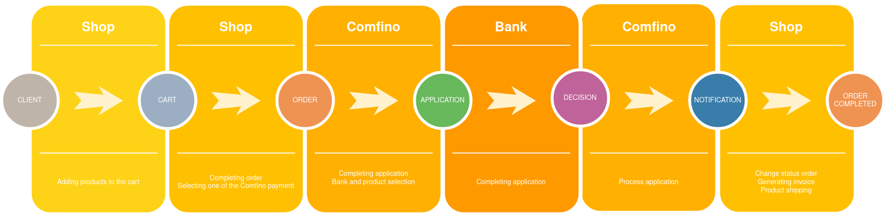
